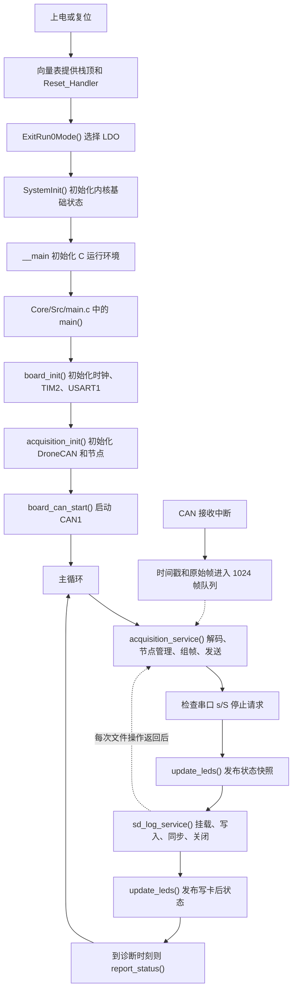

# CAN1 双传感器采集与 TF 卡记录代码说明

本文对应 `firmware/stm32h723_can1/` 固件和 `tools/decode_sd_log.py` 导出工具，按当前实现说明从复位到记录文件的执行过程，并列出工程各代码文件的职责。

Keil 工程入口为 `firmware/stm32h723_can1/MDK-ARM/stm32h723_can1.uvprojx`。建议在 Keil 中先打开 `Core/Src/main.c`，对照本文的执行顺序阅读，再查看每个被调用函数。

## 1. 整体执行关系

固件采用裸机主循环。CPU 正常执行主循环，发生 CAN 接收、TIM2 回绕或 SysTick 事件时进入对应中断，处理后返回被打断的位置。



下面三个数据层次在代码中使用不同对象。

| 数据 | 含义 | 保存位置 |
| --- | --- | --- |
| CAN 原始帧 | 一次经典 CAN 传输，包含扩展 ID、最多 8 字节数据和本地接收时间 | `board.c` 的 `rx_queue` |
| DroneCAN 完整报文 | 经 libcanard 重组及校验后的 Fix2、RawAirData、NodeStatus 或 Allocation | 协议回调中的临时结构体 |
| 二进制日志帧 | 一个 200 ms 窗口内选出的空速和 GPS 样本，以及窗口序号和 CRC | `LogRecords.records` |

空速 10:1 抽取以完整 RawAirData 报文为单位。CAN 队列仍接收所需类型的所有原始帧。

## 2. CPU 从哪里开始执行

### 2.1 启动汇编

文件为 `Drivers/CMSIS/Device/ST/STM32H7xx/Source/Templates/arm/startup_stm32h723xx.s`。该路径及下文未写完整前缀的路径，均相对固件目录。

1. CPU 从启动向量表取得初始栈顶和 `Reset_Handler` 地址。
2. `Reset_Handler` 调用 `ExitRun0Mode()`，工程通过 `USE_PWR_LDO_SUPPLY` 选择 LDO 供电并等待稳定。
3. 调用 `SystemInit()`，完成 FPU、RCC 基础复位状态等设置。
4. 跳转到 Arm C 运行库的 `__main`。运行库根据链接布局初始化可写数据和静态清零区，然后进入用户的 `main()`。

`ExitRun0Mode()` 和 `SystemInit()` 都在 `Drivers/CMSIS/Device/ST/STM32H7xx/Source/Templates/system_stm32h7xx.c` 中。`__main` 由编译器运行库提供。

启动文件还定义中断向量及默认弱处理函数。本工程在 `board.c` 中定义同名的 `FDCAN1_IT0_IRQHandler()`、`TIM2_IRQHandler()`、`SysTick_Handler()`，链接后由这些函数处理对应中断。

### 2.2 main() 的一次性初始化

| 顺序 | 调用 | 完成的工作 |
| --- | --- | --- |
| 1 | `board_init()` | 配置 LED GPIO，再依次调用 `HAL_Init()`、`clock_init()`、`timer_init()`、`uart_init()` |
| 2 | `acquisition_init(&records, board_time_us())` | 保存共享日志对象，初始化 4 KiB libcanard 内存池、回调和主控 ID 100，记录启动等待基准 |
| 3 | `board_can_start()` | 配置 PD0/PD1、CAN 位时序、硬件过滤器、FIFO 和中断，启动 FDCAN1 |
| 4 | `board_uart_write(...)` | 输出启动提示以及串口停止命令说明 |
| 5 | `for (;;)` | 永久进入主循环 |

`records` 是 `main.c` 中的静态 `LogRecords` 对象，进入 `main()` 前由 C 运行库清零。采集服务和写卡服务通过指针访问同一个对象。

### 2.3 board_init() 设置了什么

| 初始化函数 | 当前配置 | 作用 |
| --- | --- | --- |
| `HAL_Init()` | SysTick 毫秒计时 | 为 HAL 超时提供时间基准 |
| `clock_init()` | HSE 25 MHz，PLL1，CPU/HCLK 200 MHz，APB1/2 100 MHz | 配置系统和外设时钟 |
| `timer_init()` | TIM2 时钟 200 MHz，预分频 199，32 位计数 | 产生 1 MHz 微秒计时，回绕中断扩展为 64 位 |
| `uart_init()` | USART1，PA9/PA10，115200 8N1 | 串口诊断和接收 s/S 命令 |

SDMMC 的引脚和时钟在首次实际初始化卡时，由 HAL 调用 `HAL_SD_MspInit()` 配置。日志队列出现首帧后，写卡状态机才开始挂载。

在 HAL 初始化之前，`board_init()` 先配置两个 LED GPIO 并常亮。TIM2 启动后开启 SysTick 中的 LED 时序服务，使用微秒时钟计算亮灭截止时间。

关键初始化函数经过 `require()` 检查，失败时关闭中断并停在循环内，可通过 Keil 调用栈定位失败位置。

## 3. 每轮主循环执行到哪一块

### 3.1 acquisition_service() 优先服务 CAN

函数位于 `App/acquisition.c`，按以下顺序运行。

1. 调用 `board_can_recover()`，处理先前中断登记的 bus-off 恢复请求。
2. 用 `board_can_receive()` 依次取出最早的原始帧，直到软件队列为空。
3. 对每帧先调用 `advance(received_us)`，按该帧接收时间处理离线事件、窗口推进和过期传输清理。
4. 检查匿名帧的单帧传输形式，再将帧和原始时间交给 `canardHandleRxFrame()`。
5. libcanard 完成重组并通过校验后，调用 `on_transfer()`，进入对应报文处理函数。
6. 排空软件队列后，通过 `board_can_idle_time()` 原子确认硬件 FIFO 也为空。条件满足时，用当前本地时间补推窗口。
7. 到期则调用 `heartbeat()`，将主控 NodeStatus 加入发送队列。
8. 读取 libcanard 发送队列，过期帧计错丢弃，其余尝试交给硬件发送 FIFO，硬件忙时留待下一轮。

`board_can_send()` 返回成功表示硬件接收了发送请求。软件中的 `tx_errors` 统计入队失败和软件发送帧过期。

### 3.2 主循环检查停止请求

`board_stop_requested()` 轮询 USART1 收到的字符。读到 `s` 或 `S` 后，`main()` 设置 `stopping = true` 并调用 `acquisition_stop()`。

此时 `collecting` 变为 false，窗口推进停止。已经封帧进入日志队列的记录交给 `sd_log_service()` 排空。当前窗口和仍处于重组余量中的上一窗口尚未入队，其内容不会在停止时额外封帧。

主循环随后仍持续服务 CAN、心跳和串口诊断。重新开始记录需要复位 MCU。

### 3.3 sd_log_service() 推进写卡

函数位于 `App/sd_log.c`。首次建文件分为四个子阶段，每个阶段执行后返回主循环。

| 子阶段 | 调用 | 下一阶段 |
| --- | --- | --- |
| `SD_OP_MOUNT` | `f_mount()`，并检查 FAT32 | `SD_OP_OPEN` |
| `SD_OP_OPEN` | `f_open(..., FA_CREATE_NEW)`，找到可用的新文件名 | `SD_OP_HEADER` |
| `SD_OP_HEADER` | `f_write()` 写入 16 字节文件头 | `SD_OP_SYNC` |
| `SD_OP_SYNC` | `f_sync()` 提交文件头 | 公开状态变为 `SD_LOG_OPEN` |

遇到已有文件名会跳到下一个候选名，每轮尝试一个。文件名从 `LOG0001.BIN` 到 `LOG9999.BIN`，扫描一圈仍无空闲名字时进入故障重试。

文件进入 OPEN 后，满足以下任一条件就调用 `write_batch()`。

- 日志队列达到 51 帧。
- 最早记录的计划封帧时刻已经过去约 1 秒。
- 已收到停止请求，需要排空队列。

单次打包最多 51 个完整帧，共 4080 字节，使用 4 KiB 缓冲。`f_write()` 返回后同时检查返回值和写入长度，并返回主循环更新 LED 快照。下一轮再按条件执行同步或关闭。每约 2 秒有未同步记录时执行 `f_sync()`。停止且队列为空时执行 `f_close()`，成功后状态变为 CLOSED。

`after_io()` 统计单次文件操作耗时，并立即调用 `acquisition_service()`。因此 `f_write()` 与后续 `f_sync()` 之间也有 CAN 服务机会。文件操作自身仍为同步调用，期间接收中断可以继续往原始帧队列入队。

### 3.4 report_status() 输出诊断

到约 1 秒诊断时刻时，`main()` 调用 `report_status()`，读取三个模块的状态。

| 串口输出 | 数据来源 | 主要字段 |
| --- | --- | --- |
| GPS / AIR | `acquisition_stats()` 与 `LogRecords` | 在线状态、完整报文数、重启次数、缺样窗口数、迟到候选数 |
| CAN | `board_can_stats()` 与 `acquisition_stats()` | 分配次数、FIFO 丢帧事件、软件丢帧与高水位、CRC/传输/DSDL 错误、发送错误、bus-off |
| SD | `sd_log_stats()` 与 `LogRecords` | 当前状态、文件编号、最近故障阶段和返回值、短写、故障次数、未确认记录数、序号、队列与最长耗时 |

最近故障字段在恢复成功后仍保留，当前是否可写由 `state` 判断。`fifo_lost` 是硬件丢帧事件次数。`mount/write/sync_max_us` 的单位为微秒，其中关闭文件的耗时也计入同步最大值。

## 4. 一条传感器数据如何走到文件

```text
FDCAN1 接收硬件 FIFO0
  -> FDCAN1_IT0_IRQHandler()              board.c
  -> HAL_FDCAN_IRQHandler()              ST HAL
  -> HAL_FDCAN_RxFifo0Callback()          board.c，打时间戳并进入原始帧队列
  -> board_can_receive()                 主循环取出一帧
  -> canardHandleRxFrame()               libcanard，重组并校验完整传输
  -> on_transfer()                       acquisition.c
  -> DSDL decode + handle_air()/handle_gps()
  -> log_add_air()/log_add_gps()          log_record.c，按首帧时间保存最新候选
  -> log_advance() -> seal_window()       到封帧时刻
  -> log_encode()                        编码 80 字节并计算 CRC
  -> LogRecords.records                  已封帧日志队列
  -> write_batch() -> f_write()           sd_log.c / FatFs
  -> disk_write() -> transfer()           sd_diskio.c
  -> HAL_SD_WriteBlocks()                HAL 轮询 SDMMC1
  -> TF 卡上的 LOGxxxx.BIN
```

### 4.1 两个节点的管理

| 报文 | 处理函数 | 当前行为 |
| --- | --- | --- |
| Allocation，类型 ID 1 | `handle_allocation()` | 按 6 + 6 + 4 字节拼接 UID，匹配配置表，分别给 GPS 125 和空速计 124 |
| NodeStatus，类型 ID 341 | `handle_heartbeat()` | 更新该节点心跳，检测 uptime 回退，约 3 秒无心跳判离线 |
| RawAirData，类型 ID 1027 | `handle_air()` | 每条解码成功的完整报文计数，第 10、20、30……条成为候选 |
| Fix2，类型 ID 1063 | `handle_gps()` | 每条解码成功报文成为候选，包含 NO_FIX 和 TIME_ONLY |

分配交换同一时刻只推进一组 UID，前两阶段回显累计前缀并返回 ID 0，完整 UID 匹配后返回目标节点 ID。后续请求或积压请求达到约 500 ms 时限时清除分配交换状态，等待新请求。

重新分配成功、检测到重启或确认离线时，`reset_samples()` 清除该节点两个未封帧窗口的候选，并设置接收时间边界。空速抽取计数同时归零。已封帧日志队列的内容仍按原有序号写出。

### 4.2 时间窗口和首帧时间

两节点上线或启动等待约 5 秒后，`start_if_ready()` 调用 `log_start()`，将 T0 向上对齐到 200 ms 边界。其后每个窗口为半开区间。

```text
窗口 n            [T0 + n×200000, T0 + (n+1)×200000)
封帧截止时间       T0 + (n+1)×200000 + 20000
样本时间           完整 DroneCAN 传输首帧的本地接收时间
样本偏移           样本时间 - 窗口起点，范围为 0～199999 微秒
```

例如首帧在 5.1997 秒、末帧在 5.203 秒的 GPS 报文归入 `[5.0, 5.2)` 秒窗口。若该窗口的报文末帧在 5.220 秒或之后才被接收，旧窗口已经封帧，候选计入迟到。

主循环每取出一帧，先用这帧的接收时间推进窗口，再把它送入 libcanard。处理积压期间保留这条原始时间轴，接收缓冲完全为空后才用当前时间补推。

libcanard 的多帧回调在本工程中已调整为返回接收状态中保存的首帧时间。`acquisition.c` 的 `received_us` 在回调期间仍代表正在处理的末帧时间，两者用途不同。

### 4.3 缺样与测量无效

每个时间窗口都分配一个序号并产生一条记录，两个传感器都缺样时同样生成记录。节点 ID 为 0 表示窗口没有候选。一个窗口同一传感器有多个候选时，保留首帧时间最新的一条。

| 标志 | 条件 | 写入行为 |
| --- | --- | --- |
| air_flags 位 0 | 存在空速候选 | 保存节点 ID 和时间偏移 |
| air_flags 位 1 | 压差为有限值 | 保存压差，允许零值和负值 |
| gps_flags 位 0 | 存在 GPS 候选 | 保存节点 ID、偏移、状态、卫星数和时标 |
| gps_flags 位 1 | 2D/3D 定位且经纬度合法 | 保存经纬度，3D 时同时保存 MSL 高度 |
| gps_flags 位 2 | GNSS 时间非零，时标为 TAI/UTC/GPS | 保存 GNSS 时间 |
| gps_flags 位 3 | 3D 定位且 NED 三分量均为有限值 | 保存三个速度分量 |

相关测量无效时数值字段为 0，接收到的设备状态仍保留。CSV 导出工具按有效位将无效测量显示为空。

## 5. 写卡故障后代码如何继续

`storage_fault()` 登记失败阶段、FatFs 返回值和短写标记，将尚未同步确认的记录计入 `uncertain_records`，注销故障卷，并设置约 2 秒后的重试时间。

已经调用过 `f_write()` 的批次在返回后退出日志队列，结果不确定的批次由旧文件中的 CRC 及实际记录判断。后续接收与窗口组帧继续运行，日志队列满时丢新记录并累计 `dropped`。序号在尝试入队前分配，因此后续恢复文件中的序号缺口可用于定位丢失窗口。

恢复时重新挂载并创建新文件，写头及同步成功后继续写后续记录。同一次 MCU 启动的 T0 和序号延续。若停录过程中存储仍故障且队列还有记录，写卡服务继续尝试恢复，直到排空并关闭。

SDMMC 底层按最多八扇区分组进行轮询块读写，数据操作和卡就绪等待各设 300 ms 超时。HAL 命令超时为 300 ms，内部数据等待和 ACMD41 协商总等待时限为 1200 ms。这些是各层操作的时限，单次 FatFs 调用可能包含多次下层操作，其整体停顿由诊断最大耗时观察。

## 6. 各代码文件的职责

### 6.1 应用代码与板级代码

| 文件 | 主要函数或对象 | 实现功能 |
| --- | --- | --- |
| `Core/Src/main.c` | `main()`、`report_status()`、`records` | C 入口、初始化次序、主循环调度、停止请求和每秒诊断 |
| `Core/Src/board.c` | `board_init()`、`board_can_start()`、三个 IRQ 入口 | 系统/外设时钟、引脚、CAN 收发与队列、64 位时间、串口、SD MSP 回调、bus-off 恢复 |
| `Core/Inc/board.h` | `BoardCanFrame`、`BoardCanStats`、`board_*` 声明 | 向采集模块暴露板级 CAN、时间和串口接口 |
| `Core/Src/sd_diskio.c` | `disk_initialize/status/read/write/ioctl()` | 将 FatFs 逻辑扇区请求适配到 HAL SDMMC1，维护卡状态和对齐中转缓冲 |
| `Core/Inc/stm32h7xx_hal_conf.h` | HAL 模块宏、HSE、SD 超时配置 | 选择驱动模块并为底层提供编译配置 |
| `App/nodes.h` | 三个节点 ID 宏 | 主控 100、GPS 125、空速计 124 的集中定义 |
| `App/acquisition.c` | `acquisition_service()`、节点 UID 表、`on_transfer()` | DroneCAN 接收/发送调度、分配器、心跳、重启/离线监测、空速抽取、GPS 候选 |
| `App/acquisition.h` | `AcquisitionStats`、采集接口声明 | 定义采集诊断及主循环/写卡服务使用的接口 |
| `App/log_record.c` | `log_advance()`、`seal_window()`、`log_encode()` | 200 ms 双窗口、迟到判定、最新候选选择、有效位、固定偏移小端编码、CRC、64 帧队列 |
| `App/log_record.h` | `AirSample`、`GpsSample`、`LogWindow`、`LogRecords` | 定义采样单位、窗口状态、文件格式常量、日志队列和接口 |
| `App/sd_log.c` | `sd_log_service()`、`open_file_step()`、`write_batch()` | 分步建文件、批量写入、周期同步、故障重挂载和关闭 |
| `App/sd_log.h` | `SdLogState`、`SdLogOperation`、`SdLogStats` | 写卡公开状态、故障操作类别、统计和接口 |
| `App/status_led.c` | `status_led_prepare()`、`status_led_tick()` | 就绪条件和有效期快照、LED1 快慢闪相位、LED2 UTC 边界报时及时间跳变处理 |
| `App/status_led.h` | `StatusLedSnapshot`、`StatusLedController`、`StatusLedOutput` | 主循环到 SysTick 的快照、时序状态和逻辑灯光输出定义 |
| `tests/test_can1_windows.c` | 独立的测试 `main()` 和板级替身 | 在内存中构造多帧 Fix2，验证跨界首帧归属和截止时刻迟到，供 PC 或模拟器执行 |
| `tests/test_status_led.c` | LED 确定性时序测试 | 验证快慢闪、单闪双闪、相位保持、授时超时、跳时和主循环停顿 |
| `tests/test_acquisition_status.c` | DroneCAN 状态集成测试 | 验证运行心跳、完整报文就绪、UTC/TAI/GPS 换算、未知时标/闰秒、重启和离线 |
| `tests/test_sd_led_status.c` | FatFs 替身测试 | 验证首次写数据、同步失败、短写、重挂载与关闭时的写卡就绪状态 |
| `tools/decode_sd_log.py`（相对仓库根目录） | `main()`、`read_header()`、`export_records()` | 校验文件头、逐帧 CRC、序号与时间连续性，流式生成 CSV |

### 6.2 libcanard 和 FatFs

| 文件 | 实现功能 |
| --- | --- |
| `ThirdParty/libcanard/canard.c` | CAN 传输层、多帧重组、transfer-ID/Toggle/CRC、发送队列、固定内存池、过期传输回收 |
| `ThirdParty/libcanard/canard.h` | 对外的帧/传输/实例数据类型、回调签名、错误码和 API |
| `ThirdParty/libcanard/canard_internals.h` | 传输描述、内部状态与内存块结构、内部算法声明 |
| `ThirdParty/FatFs/source/ff.c` | FAT 文件系统实现，处理挂载、目录、文件分配、数据和元数据缓存 |
| `ThirdParty/FatFs/source/ff.h` | `FATFS`、`FIL`、`FRESULT` 等类型和文件 API |
| `ThirdParty/FatFs/source/ffconf.h` | 单卷、512 字节扇区、8.3 文件名、无 RTC、关闭 exFAT 等配置 |
| `ThirdParty/FatFs/source/diskio.h` | 逻辑扇区读写与控制命令接口，由 `sd_diskio.c` 实现 |

### 6.3 DSDL 生成代码

下表每一行对应 `ThirdParty/DSDL/src/` 中的一个 `.c` 文件和 `ThirdParty/DSDL/include/` 中的同名 `.h` 文件。头文件定义消息字段、类型 ID、签名和字段级编码逻辑，源文件提供顶层编解码入口。

| 文件 | 实现功能及调用者 |
| --- | --- |
| `uavcan.protocol.dynamic_node_id.Allocation.c`、`uavcan.protocol.dynamic_node_id.Allocation.h` | 动态分配请求/应答编解码，供 `handle_allocation()` 使用 |
| `uavcan.protocol.NodeStatus.c`、`uavcan.protocol.NodeStatus.h` | 节点状态编解码，供 `handle_heartbeat()` 和 `heartbeat()` 使用 |
| `uavcan.equipment.air_data.RawAirData.c`、`uavcan.equipment.air_data.RawAirData.h` | 空速、气压、温度及协方差编解码，采集代码提取原始压差 |
| `uavcan.equipment.gnss.Fix2.c`、`uavcan.equipment.gnss.Fix2.h` | 定位、速度、GNSS 时间及状态编解码，供 `handle_gps()` 使用 |
| `uavcan.Timestamp.c`、`uavcan.Timestamp.h` | Fix2 内嵌的微秒时间戳类型编解码 |
| `uavcan.equipment.gnss.ECEFPositionVelocity.c`、`uavcan.equipment.gnss.ECEFPositionVelocity.h` | Fix2 可选 ECEF 位置/速度复合字段编解码，应用日志当前提取 LLA 与 NED 字段 |

### 6.4 ST HAL 驱动

下表中的源文件位于 `Drivers/STM32H7xx_HAL_Driver/Src/`，头文件位于同级 `Inc/`。每个 `.c` 实现相应模块函数，每个同名 `.h` 提供结构体、宏和声明。驱动中包含可供其他配置使用的功能，最终链接器保留实际引用的部分。

| 文件 | 实现功能及当前关联 |
| --- | --- |
| `stm32h7xx_hal.c`、`stm32h7xx_hal.h` | HAL 基础初始化、毫秒计时与通用服务，供 `board_init()`、SysTick 和超时使用 |
| `stm32h7xx_hal_cortex.c`、`stm32h7xx_hal_cortex.h` | NVIC、SysTick、内核配置，供中断优先级和 HAL 时基设置使用 |
| `stm32h7xx_hal_rcc.c`、`stm32h7xx_hal_rcc.h` | 振荡器、PLL、系统及总线时钟，供 `clock_init()` 使用 |
| `stm32h7xx_hal_rcc_ex.c`、`stm32h7xx_hal_rcc_ex.h` | 外设时钟选择与扩展时钟设置，关联 FDCAN、SDMMC 和 USART1 |
| `stm32h7xx_hal_pwr.c`、`stm32h7xx_hal_pwr.h` | 基础电源控制及电压等级支持 |
| `stm32h7xx_hal_pwr_ex.c`、`stm32h7xx_hal_pwr_ex.h` | 供电方式和扩展电源控制，关联 LDO 设置 |
| `stm32h7xx_hal_gpio.c`、`stm32h7xx_hal_gpio.h` | GPIO 模式、上下拉、速度和复用设置 |
| `stm32h7xx_hal_gpio_ex.h` | 引脚复用功能编号，供 CAN、UART、SD 引脚选择使用 |
| `stm32h7xx_hal_fdcan.c`、`stm32h7xx_hal_fdcan.h` | FDCAN 初始化、过滤器、硬件收发 FIFO、中断分发和错误回调 |
| `stm32h7xx_hal_tim.c`、`stm32h7xx_hal_tim.h` | 定时器基础初始化和启动，本工程使用 TIM2 |
| `stm32h7xx_hal_tim_ex.c`、`stm32h7xx_hal_tim_ex.h` | 定时器扩展功能，作为 HAL TIM 驱动配套模块 |
| `stm32h7xx_hal_uart.c`、`stm32h7xx_hal_uart.h` | UART 初始化、轮询发送及其他收发接口，本工程使用 USART1 |
| `stm32h7xx_hal_uart_ex.c`、`stm32h7xx_hal_uart_ex.h` | UART 扩展功能及初始化辅助 |
| `stm32h7xx_hal_sd.c`、`stm32h7xx_hal_sd.h` | SD 卡识别、初始化、块读写、状态和总线宽度处理，本工程使用轮询读写并增加协商时限 |
| `stm32h7xx_hal_sd_ex.c`、`stm32h7xx_hal_sd_ex.h` | SD 扩展功能，提供驱动配套接口 |
| `stm32h7xx_ll_sdmmc.c`、`stm32h7xx_ll_sdmmc.h` | SDMMC 命令、响应、数据通道和寄存器操作，命令超时支持工程配置覆盖 |
| `stm32h7xx_ll_delayblock.h` | SDMMC 延迟块的寄存器级辅助函数 |
| `stm32h7xx_hal_flash.c`、`stm32h7xx_hal_flash.h` | Flash 控制、延时和访问支持，HAL 初始化和时钟配置使用相关定义 |
| `stm32h7xx_hal_flash_ex.c`、`stm32h7xx_hal_flash_ex.h` | Flash 扩展操作，作为 HAL 配套模块 |
| `stm32h7xx_hal_dma.c`、`stm32h7xx_hal_dma.h` | DMA 通道及传输管理，为 HAL 驱动的 DMA 接口提供依赖 |
| `stm32h7xx_hal_dma_ex.c`、`stm32h7xx_hal_dma_ex.h` | DMA 扩展接口，为 HAL 配套提供依赖 |
| `stm32h7xx_hal_def.h` | HAL 状态、锁、回调及常用通用宏 |
| `Legacy/stm32_hal_legacy.h` | HAL 历史符号兼容定义 |

### 6.5 CMSIS 内核和芯片支持

芯片相关文件位于 `Drivers/CMSIS/Device/ST/STM32H7xx/`。

| 文件 | 实现功能 |
| --- | --- |
| `Source/Templates/arm/startup_stm32h723xx.s` | 复位入口、中断向量、默认弱处理函数，以及 8 KiB 栈和 512 字节堆空间定义 |
| `Source/Templates/system_stm32h7xx.c` | 早期供电、FPU 和 RCC 基础状态、系统时钟变量更新 |
| `Include/system_stm32h7xx.h` | 系统时钟变量和 SystemInit/SystemCoreClockUpdate 声明 |
| `Include/stm32h7xx.h` | 根据 STM32H723xx 等编译宏选择对应芯片头文件 |
| `Include/stm32h723xx.h` | H723 寄存器地址、结构体、位定义和中断号 |

内核公共头文件位于 `Drivers/CMSIS/Include/`。

| 文件 | 实现功能 |
| --- | --- |
| `core_cm7.h` | Cortex-M7 内核寄存器、NVIC、SysTick、SCB 和内核操作接口 |
| `cmsis_compiler.h` | 按编译器选择适配头文件 |
| `cmsis_armclang.h` | Arm Compiler 6 的内联指令、屏障、PRIMASK 等适配，本工程实际使用 |
| `cmsis_armcc.h` | Arm Compiler 5 的适配 |
| `cmsis_gcc.h` | GCC 的适配 |
| `cmsis_iccarm.h` | IAR 的适配 |
| `cmsis_version.h` | CMSIS 版本定义 |
| `mpu_armv7.h` | ARMv7 MPU 区域配置辅助 |
| `cachel1_armv7.h` | 一级指令/数据缓存操作辅助 |

## 7. 工程配置文件和内存布局

| 文件 | 作用 |
| --- | --- |
| `MDK-ARM/stm32h723_can1.uvprojx` | Keil 工程，登记编译文件、包含目录、器件、宏、编译器与链接配置 |
| `MDK-ARM/stm32h723_can1.uvoptx` | Keil 调试器、SWD、下载和界面选项 |
| `MDK-ARM/DebugConfig/*.dbgconf` | Keil 器件包产生的调试寄存器及冻结配置 |
| `MDK-ARM/stm32h723_can1.sct` | Scatter 链接布局，Flash 从 0x08000000 开始，可写区域使用 0x24000000 的 AXI SRAM |
| `stm32h723_can1.ioc` | CubeMX 板级配置快照，供查看引脚与时钟资源 |
| `README.md` | 构建、上板、导出命令和固定依赖版本 |

Flash 区域为 1 MiB，AXI SRAM 链接区域为 320 KiB。静态 CAN 队列、libcanard 池、窗口、日志队列、打包缓冲和栈均由链接器放置在可写区域。`SDMMC1` 当前使用 HAL 轮询块读写。

## 8. PC 端导出执行顺序

将 TF 卡放入读卡器后，从仓库根目录执行。

```powershell
python tools/decode_sd_log.py E:/LOG0001.BIN -o LOG0001.csv
```

导出工具的调用顺序为 `__main__ -> main() -> read_header() -> export_records()`。

1. `main()` 解析输入和输出路径，打开二进制文件。
2. `read_header()` 校验 16 字节文件头中的标记、版本、80 字节记录长度和 200000 微秒周期。
3. `export_records()` 每次读取 80 字节，校验前 76 字节的 CRC，跳过损坏整帧并报告其文件偏移。
4. 根据序号差检查时间差，报告序号缺口、重复序号和时间异常。
5. 根据有效位将缺样或无效测量设为空单元格，保留整数时间戳、偏移和有效状态后写入 CSV。
6. 文件末尾不足 80 字节时报告剩余长度并结束。CSV 与诊断分别输出到文件/标准输出和标准错误流。

## 9. 便于跟踪流程的 Keil 断点

| 想观察的阶段 | 断点位置 | 关注内容 |
| --- | --- | --- |
| 是否执行到应用入口 | `main()` | 一次性初始化是否返回 |
| 哪项板级初始化失败 | `require()` 的失败分支 | 调用栈和 HAL 返回值 |
| CAN 是否进入软件 | `HAL_FDCAN_RxFifo0Callback()` | 帧 ID、长度、rx_head/rx_tail |
| 完整报文是否通过校验 | `on_transfer()` | data_type_id、source_node_id、timestamp_usec |
| 样本是否被选中 | `handle_air()` / `handle_gps()` | 空速抽取计数、候选时间、设备状态 |
| 是否按期封帧 | `seal_window()` | 窗口起点、next_sequence、count |
| 是否开始建日志文件 | `open_file_step()` | open_step、FatFs 返回值 |
| 是否写到卡 | `write_batch()`、`disk_write()` | 记录数、写入长度、扇区号 |
| 故障发生在哪一层 | `storage_fault()` | op、result、short_write |

在接收中断或主循环中长时间停在断点会改变接收积压与分配时限，连续采集质量可结合运行时串口统计观察。

## 10. 两颗 LED 的执行链路

逻辑 LED1 使用 PA15，对应板级原理图的 LED2；逻辑 LED2 使用 PD15，对应原理图的 LED3，均低电平点亮。原理图 LED1 是固定电源指示灯。

`main.c` 的 `update_leds()` 在采集服务与停止请求处理后、写卡服务返回后各执行一次。它读取 `acquisition_status()`、`records.collecting` 和 `sd_log_stats()`，通过 `status_led_prepare()` 生成快照，再调用 `board_led_update()` 在短临界区中发布。文件写入返回主循环后先更新快照，下一轮才继续同步或关闭。

`SysTick_Handler()` 每毫秒在更新 HAL 时基后，读取快照和 `board_time_us()`，执行 `status_led_tick()` 并设置两个 GPIO。即使主循环在等待 TF 卡，SysTick 仍按绝对截止时间处理灯光。

| 逻辑灯 | 条件 | 输出 |
| --- | --- | --- |
| LED1 | 任一节点离线、心跳模式非 Operational、无完整报文、报文已满 1 秒、未开始记录或当前文件尚无成功数据写入 | 常亮 |
| LED1 | 两节点就绪且正在成功记录，GPS 未达到 3D_FIX 或卫星数少于 6 | 亮 250 ms、灭 250 ms，周期 500 ms |
| LED1 | 两节点就绪且正在成功记录，GPS 为 3D_FIX 且卫星数至少 6 | 亮 250 ms、灭 1750 ms，周期 2000 ms |
| LED2 | 尚无有效授时、有效授时已满 1 秒、GPS 重启或离线 | 常亮 |
| LED2 | 有效 UTC 时间到达下一整分边界 | 亮 500 ms 一次 |
| LED2 | 有效 UTC 时间到达下一半分边界 | 亮 500 ms、灭 500 ms、再亮 500 ms |
| LED2 | 授时有效且没有报时事件 | 熄灭 |

就绪状态使用每条解码成功的完整传感器报文，空速第 1 条即可提供状态输入。GPS 定位和卫星数也使用最新完整 Fix2，独立于日志窗口中选中的候选。

`gps_time_utc()` 根据 Fix2 定义换算授时，UTC 直接使用，TAI 减去 `num_leap_seconds + 10` 秒，GPS 减去 `num_leap_seconds - 9` 秒。零时间、未知时标、换算所需闰秒未知或换算结果非法时保留上一次有效锚点，并由其原有的 1 秒有效期决定超时。

控制器用 UTC 锚点与本地单调时钟推算未来 00/30 秒边界，按 UTC 事件时间去重。初次获得授时、超时恢复、GPS 状态代次改变或校时跳变达到 1 秒时，取消正在播放的脉冲并安排下一未来边界。小幅校时跨过边界时按估计边界本地时刻计算剩余脉冲，已触发事件不会重播。

时间快照带有 `time_generation`。GPS 重启、离线、重新分配会递增该值，即使主循环在一次积压回放中又获得了新授时，SysTick 也能识别旧报时状态需要取消。

主循环只在 LED1 模式改变时重置闪烁相位，同一模式下重复发布快照会延续相位。TF 卡故障时清除 `data_written`；恢复创建新文件后，文件头写入与同步完成仍保持等待，直到完整数据批次成功写入才允许 LED1 闪烁。

授时指示的边界由 Fix2 接收时间和本地时钟推算，实际对时精度包含设备发送及总线接收延迟。板上脉宽与周期可通过示波器或逻辑分析仪核验。
